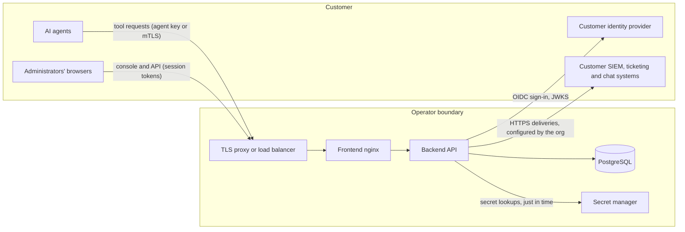

# Security overview

GreyGuard is a control plane that decides, records and can stop the actions of AI agents. Agents ask GreyGuard before acting; GreyGuard applies the organization's policy, may require a human approval, and records evidence of every decision.

## Components and trust boundaries

The shipped production deployment runs three containers on one host [TC-ARCH-1]:

- **Frontend (nginx).** Serves the web console and is the only path to the API. It runs as the unprivileged `nginx` user with all Linux capabilities dropped and a read-only root filesystem [TC-ARCH-2].
- **Backend (Python, FastAPI).** Runs as the unprivileged `greyguard` user. It has no published port and sits on an internal-only container network that only the frontend can reach [TC-ARCH-3].
- **PostgreSQL.** The database of record. Production startup is refused unless a PostgreSQL URL is configured [TC-ARCH-4].

TLS is terminated in front of the frontend by the operator's reverse proxy or load balancer; see [Data protection](data-protection.md).

## Data flow (hosted deployment)

Every outbound connection goes to an endpoint that the operator or the customer configured; the software has no built-in destination of its own [TC-SUB-1]. In the hybrid model, the customer's gateway pulls signed policy bundles from the control plane instead of agents calling the control plane directly [TC-ARCH-6].

## Security properties

- **Fail closed.** An agent action needs a decision. If the database is unavailable, agents receive errors rather than decisions, so no action is allowed without one [TC-ARCH-5].
- **Signed policy distribution.** Gateway bundles are signed with Ed25519; gateways hold only the public key, refuse bundles that fail verification, replay or have expired, and deny everything once their offline allowance (5 minutes to 7 days, default 1 hour) runs out [TC-ARCH-6].
- **Contained execution.** The optional Docker sandbox is off by default and accepts only predefined job identifiers, never shell commands, code, images, URLs or host paths. Its profile has no network, a read-only root filesystem, no added capabilities and fixed resource limits [TC-ARCH-7].
- **Tamper-evident evidence.** Audit events are sealed into a SHA-256 hash chain. Verification detects edits, missing records and reordering; authorized deletions are recorded as erasures [TC-PR-3].
- **Threat register.** Thirty roadmap threats are tracked with controls, residual risk, test evidence, owner and review date. The register states that it does not replace penetration testing or independent assessment [TC-ARCH-8].

## Deployment models

GreyGuard is offered as Hosted, Hybrid, Dedicated and Self-hosted. Each model's data boundary and the split of responsibilities are documented per model [TC-ARCH-9]. Customer-managed keys and private connectivity are **not offered** in any model [TC-DP-9].
